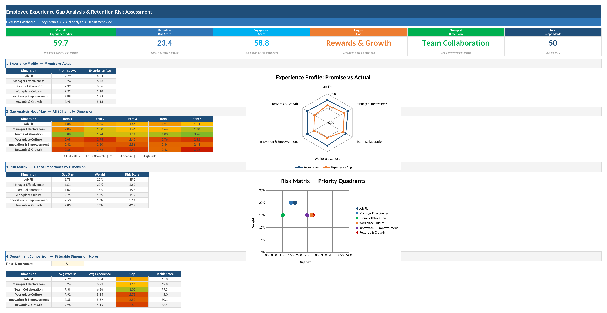
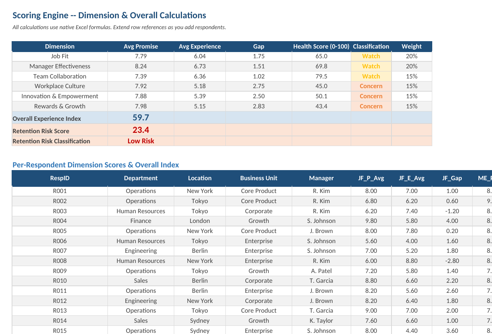
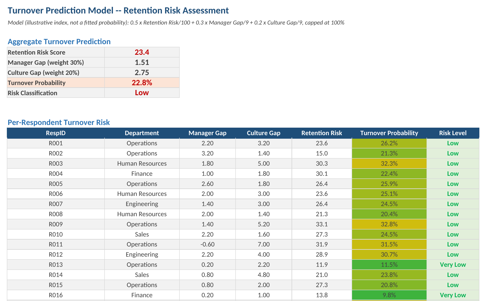
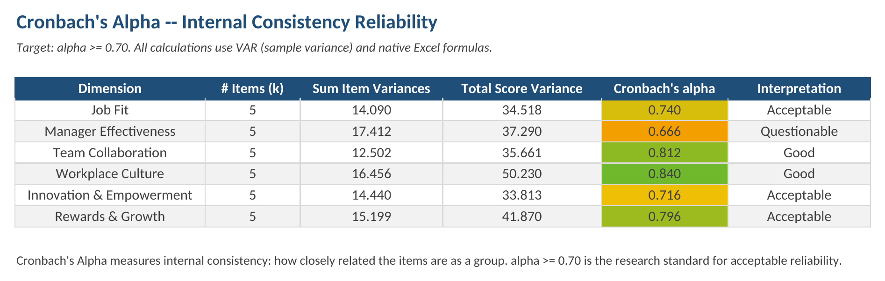
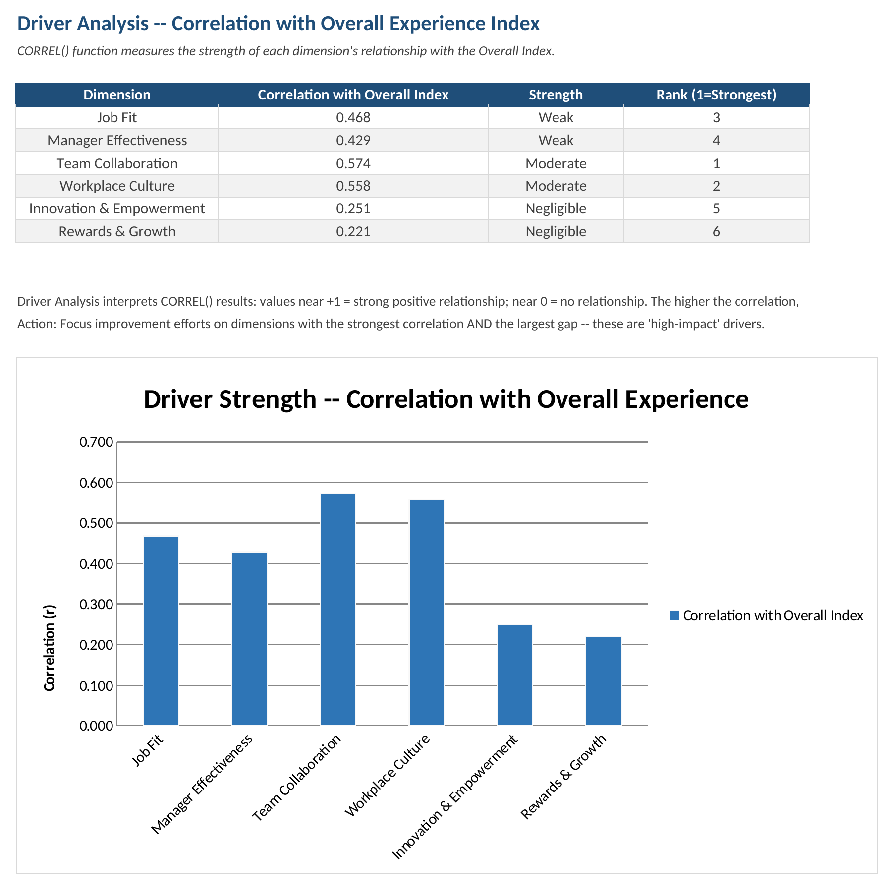
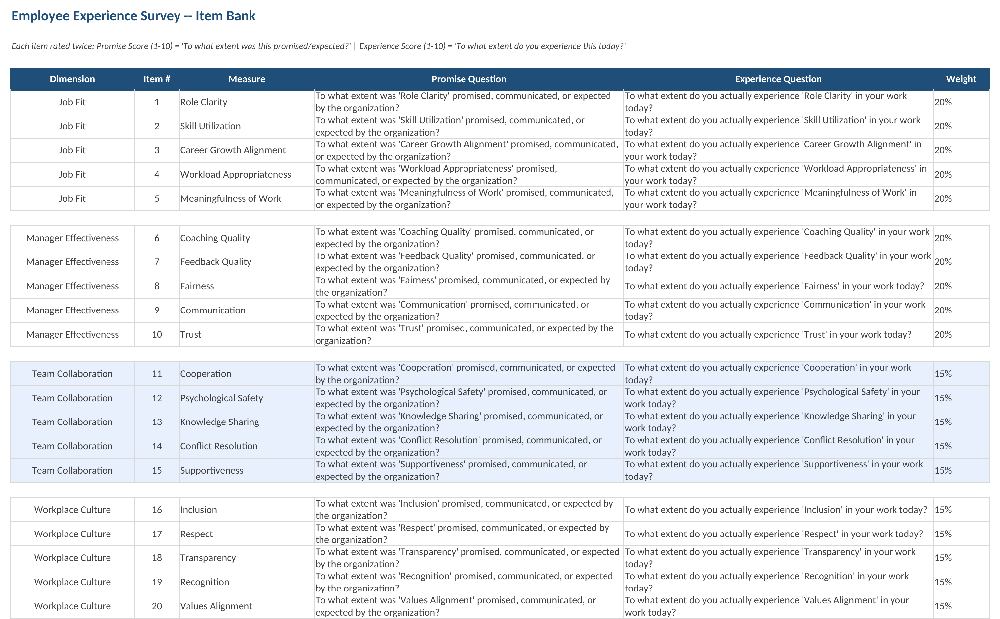

<div align="center">

# Employee Experience Gap Analysis

**A formula-driven Excel workbook that measures the gap between what an organisation promises and what employees experience, and turns it into retention-risk signals.**

Native Excel formulas throughout, no VBA, regenerated reproducibly from a single Python script.

[](employee-experience-gap-analysis.xlsx)
[](generate_workbook.py)
[](#how-scoring-works)
[](LICENSE)
[](https://github.com/mutima89/employee-experience-gap-analysis/commits)

[Overview](#overview) · [Screenshots](#screenshots) · [Quick start](#quick-start) · [Dimensions](#the-six-dimensions) · [Scoring](#how-scoring-works) · [Regenerate](#regenerating-the-workbook)



</div>

---

## Overview

Satisfaction surveys ask how people feel. This workbook asks each item twice — *was it promised?* and *do you experience it?* — and analyses the difference. Large gaps in high-weight dimensions are where disengagement and attrition tend to start.

| Sheet | What it contains |
|---|---|
| **Survey** | Item bank: 30 items in 6 dimensions, each with a promise question and an experience question (1–10) |
| **Raw Data** | One row per respondent: department, location, business unit, manager, 60 scores; capacity 500 respondents |
| **Scoring Engine** | Per-dimension averages, gaps, health scores and classifications; Overall Experience Index; Retention Risk; per-respondent profiles |
| **Dashboard** | KPI tiles, promise-vs-actual radar, 30-item gap heat map, risk matrix, department filter |
| **Reliability Analysis** | Cronbach's alpha per dimension with interpretation |
| **Driver Analysis** | Correlation of each dimension with overall experience, ranked, with chart |
| **Turnover Prediction** | Aggregate and per-respondent turnover-risk index with risk levels |

Ships with 50 synthetic respondents across 6 departments so every sheet is populated on first open.

## Screenshots

| Scoring engine | Turnover prediction |
|:---:|:---:|
|  |  |
| **Reliability (Cronbach's alpha)** | **Driver analysis** |
|  |  |

<details>
<summary>Survey item bank</summary>



</details>

## Quick start

1. Download [`employee-experience-gap-analysis.xlsx`](employee-experience-gap-analysis.xlsx) and open it in Excel 2016 or later (Windows or Mac) or Microsoft 365.
2. Replace the sample rows in **Raw Data** with your responses (scores 1–10; entry is validated).
3. Every other sheet recalculates. Use the **Department** filter on the Dashboard to compare groups.

## The six dimensions

| Dimension | Weight | Items |
|---|---|---|
| Job Fit | 20% | Role clarity, skill utilisation, career-growth alignment, workload, meaningfulness of work |
| Manager Effectiveness | 20% | Coaching, feedback, fairness, communication, trust |
| Team Collaboration | 15% | Cooperation, psychological safety, knowledge sharing, conflict resolution, supportiveness |
| Workplace Culture | 15% | Inclusion, respect, transparency, recognition, values alignment |
| Innovation & Empowerment | 15% | Autonomy, decision authority, idea acceptance, learning opportunities, experimentation support |
| Rewards & Growth | 15% | Compensation fairness, promotion opportunities, recognition, training, career progression |

Weights are design assumptions informed by engagement research, not coefficients fitted to turnover data. Recalibrate them against your own history before relying on the risk outputs.

## How scoring works

All formulas are native Excel (`AVERAGE`, `SUMPRODUCT`, `VAR.S`, `CORREL`, `RANK`, `INDEX/MATCH`).

```text
Gap            = Avg(promise items) − Avg(experience items)               per dimension, 1–10 scale
Health score   = MAX(0, MIN(100, 100 − Gap × 20))                         0–100
Classification : ≤ 1 Healthy · ≤ 2 Watch · ≤ 3 Concern · > 3 High Risk

Overall Experience Index = SUMPRODUCT(Health scores, Weights) / SUM(Weights)
Engagement Score         = average of the six health scores
```

**Retention Risk (0–100).** Weighted positive gaps (negative gaps, i.e. over-delivery, count as 0), scaled by the largest possible gap of 9:

```text
Risk = MIN(100, 100 × (0.25·Manager + 0.20·Culture + 0.20·Rewards + 0.15·JobFit + 0.10·Team + 0.10·Innovation) / 9)
       0–20 Very Low · 21–40 Low · 41–60 Moderate · 61–80 High · 81–100 Critical
```

**Turnover index (0–100%).** An illustrative index, not a statistically fitted probability:

```text
Turnover = MIN(100%, 0.5 × Risk/100 + 0.3 × Manager gap/9 + 0.2 × Culture gap/9)
           ≤ 20% Very Low · ≤ 40% Low · ≤ 60% Moderate · ≤ 80% High · > 80% Critical
```

**Reliability.** Cronbach's alpha per dimension, `α = k/(k−1) × (1 − Σ VAR.S(item) / VAR.S(total))`, interpreted from ≥ 0.9 Excellent down to < 0.5 Unacceptable; 0.70 is the usual minimum.

**Drivers.** `CORREL`, across respondents, of each dimension's experience score with the respondent's overall experience score: |r| ≥ 0.7 strong, ≥ 0.5 moderate, ≥ 0.3 weak.

### Results on the sample data

| Output | Value |
|---|---|
| Overall Experience Index | 59.7 |
| Retention Risk | 23.4 (Low) |
| Turnover index | 22.8% (Low); respondents range 6%–41% |
| Largest gap | Rewards & Growth (2.83) |
| Cronbach's alpha | 0.67–0.84 (one Questionable, three Acceptable, two Good) |
| Strongest driver | Team Collaboration (r = 0.57) |

## Regenerating the workbook

```bash
pip install openpyxl
python generate_workbook.py
```

The generator builds every sheet, formula, chart, conditional format and validation rule from scratch with a fixed random seed, so the output is identical on every run. Sample respondents share a per-person level within each dimension plus item-level noise, so the reliability statistics behave like real survey data.

Outputs were verified by recalculating the generated file in LibreOffice: no formula errors, and the values above.

## Project structure

```text
employee-experience-gap-analysis/
├── employee-experience-gap-analysis.xlsx   The workbook
├── generate_workbook.py                    Reproducible generator
├── docs/screenshots/
└── LICENSE
```

## License

MIT — see [LICENSE](LICENSE).
